# Implementation Plan — Step 1: Build Foundation, Toolchains & CI Infrastructure

> **Milestone:** Step 1 (Person 1 / Person A Scope)  
> **Status:** Completed · **Date:** 2026-10-14  
> **Target Platform:** Linux Desktop (x86_64, aarch64)  
> **Language Standard:** C++20 | **Build System:** CMake 3.22+  
> **Author:** Person 1 (Systems & Storage Engineer)  
> **Branch:** `foundation` (corresponds to `feat/step-01-person1`)

---

## 1. Overall Objective (What, How, and Why)

### 1.1 What
Construct the foundational modern C++20 build framework, root CMake configuration, compiler diagnostics, sanitizers (ASan, UBSan, TSan), third-party dependency orchestration, code style formatters, static analysis linters, and GitHub Actions CI pipelines for the Rewind project.

### 1.2 How
1. Author root `CMakeLists.txt` targeting C++20 (`cxx_std_20`) with clean modular includes in `cmake/`.
2. Configure `cmake/CompilerWarnings.cmake` enforcing strict zero-warning compilation (`-Wall -Wextra -Wpedantic -Werror`).
3. Configure `cmake/Sanitizers.cmake` providing AddressSanitizer, UndefinedBehaviorSanitizer, and ThreadSanitizer configurations with mutual-exclusion enforcement between ASan and TSan.
4. Configure `cmake/Dependencies.cmake` automating GoogleTest (via `FetchContent` v1.14.0 fallback) and SQLite3 discovery with clean include boundary isolation.
5. Create `CMakePresets.json` with standardized configure, build, and test presets (`debug`, `release`, `asan`, `tsan`).
6. Establish style and linting enforcement via `.clang-format` (LLVM style, C++20, 4-space indentation) and `.clang-tidy` (bugprone, modernize, readability, and performance checks).
7. Implement `.github/workflows/ci.yml` matrix testing across Ubuntu 24.04 with GCC 13 and Clang 17, runtime sanitizers, and formatting compliance.

### 1.3 Why
A zero-warning, reproducible build foundation prevents subtle compiler disparities, memory bugs, concurrency race hazards, and code quality drift before domain code is introduced. Decoupling the build foundation from domain implementations ensures seamless parallel development between Person 1 and Person 2 without merge collisions.

---

## 2. Tech Stack and Tooling

| Component | Technology | Version / Specification | Rationale |
|---|---|---|---|
| **Core Standard** | Modern C++ | C++20 (`-std=c++20`) | Concepts, `std::span`, `std::string_view`, monadic operations, and zero-overhead systems modeling. |
| **Build System** | CMake | 3.22+ (tested up to 3.31.4) | Standard cross-platform build orchestrator with native preset support. |
| **Presets Specification** | CMakePresets.json | Schema Version 3 | Reproducible developer build presets across CLI and IDEs. |
| **Target Compilers** | GCC / Clang | GCC 13+, Clang 17+ | Full C++20 conformance, high-performance optimization, and robust sanitizer runtime support. |
| **Test Framework** | GoogleTest | v1.14.0 | Industry-standard C++ unit testing and mock framework with CTest integration. |
| **Linters & Formatters** | Clang-Format / Clang-Tidy | LLVM style rules | Automated styling and static analysis to enforce C++ Core Guidelines. |
| **Continuous Integration**| GitHub Actions | Ubuntu 24.04 runner | Automated multi-compiler validation on PR and push. |

---

## 3. Architecture and Visual Diagrams

```mermaid
graph TD
    Root[CMakeLists.txt] --> Warnings[cmake/CompilerWarnings.cmake]
    Root --> Sanitizers[cmake/Sanitizers.cmake]
    Root --> Deps[cmake/Dependencies.cmake]
    
    Deps --> GTest[GoogleTest v1.14.0 FetchContent / FindPackage]
    Deps --> SQLite[SQLite3 Target Discovery]
    
    Root --> CoreLib[Target: rewind_core Static/Interface Library]
    Root --> CLIExec[Target: rewind_cli Executable if src/main.cpp]
    Root --> TestTarget[Target: test_common Executable & CTest Runner]

    Presets[CMakePresets.json] --> Debug[debug Preset]
    Presets --> Release[release Preset]
    Presets --> ASan[asan Preset: ASan + UBSan]
    Presets --> TSan[tsan Preset: TSan]

    CI[.github/workflows/ci.yml] --> GCC13[Ubuntu 24.04: GCC 13 Debug & Release]
    CI --> Clang17[Ubuntu 24.04: Clang 17 Debug & Release]
    CI --> SanRun[Ubuntu 24.04: ASan & TSan Validation]
    CI --> FmtCheck[Code Formatting Check]
```



---

## 4. File and Folder Manifest

| File Path | Action | Role & Responsibility |
|---|---|---|
| `CMakeLists.txt` | Created | Master CMake build definition and target orchestration. |
| `CMakePresets.json` | Created | Presets for debug, release, asan, and tsan (configure, build, test). |
| `cmake/CompilerWarnings.cmake` | Created | Strict compiler flags (`-Wall -Wextra -Wpedantic -Werror`). |
| `cmake/Sanitizers.cmake` | Created | Address, Undefined Behavior, and Thread Sanitizer flags. |
| `cmake/Dependencies.cmake` | Created | Dependency management for GoogleTest and SQLite3. |
| `.clang-format` | Created | LLVM-based code formatting configuration. |
| `.clang-tidy` | Created | Static analysis rules for modern C++20 best practices. |
| `.github/workflows/ci.yml` | Created | Automated CI pipeline with GCC 13 and Clang 17 matrix. |
| `Implementations/step_01_build_foundation.md` | Created | Archival implementation report for Step 1. |

---

## 5. Granular Change Breakdown

### 5.1 `CMakeLists.txt`
- Configured minimum version `3.22...3.31` and project metadata `Rewind 0.1.0`.
- Enforced `CMAKE_CXX_STANDARD 20`, `CMAKE_CXX_STANDARD_REQUIRED ON`, and `CMAKE_CXX_EXTENSIONS OFF`.
- Enabled `CMAKE_EXPORT_COMPILE_COMMANDS ON` for clangd and clang-tidy integration.
- Defined library `rewind_core`: dynamically detects domain sources in `src/` (excluding `main.cpp`). Operates as an `INTERFACE` library prior to Person 2 merging domain sources, and promotes to a `STATIC` library once sources are present.
- Configured conditional target `rewind_cli` mapped to `src/main.cpp`.
- Structured CTest suite with GoogleTest discovery and a baseline verification test (`rewind_foundation_check`).

### 5.2 `cmake/CompilerWarnings.cmake`
- Implemented `rewind_set_compiler_warnings(TARGET_NAME)`.
- Applied `-Wall -Wextra -Wpedantic -Wshadow -Wnon-virtual-dtor -Wold-style-cast -Wcast-align -Wunused -Woverloaded-virtual -Wnull-dereference -Wdouble-promotion -Wformat=2 -Wimplicit-fallthrough -Wconversion -Wsign-conversion` on Clang/GCC.
- Added GCC-specific flags: `-Wlogical-op -Wduplicated-cond -Wduplicated-branches -Wuseless-cast`.
- Added MSVC equivalent flags (`/W4 /permissive-`) and optional warning-as-error controls (`REWIND_WARNINGS_AS_ERRORS`).

### 5.3 `cmake/Sanitizers.cmake`
- Implemented `rewind_set_sanitizers(TARGET_NAME)`.
- Added mutually exclusive options `REWIND_ENABLE_ASAN`, `REWIND_ENABLE_UBSAN`, and `REWIND_ENABLE_TSAN`.
- Injected `-fsanitize=address,leak`, `-fsanitize=undefined`, and `-fsanitize=thread` flags along with `-fno-omit-frame-pointer -g` on both compile and link stages.

### 5.4 `cmake/Dependencies.cmake`
- Integrated GoogleTest via `FetchContent` (release v1.14.0) with local `find_package(GTest QUIET)` fallback.
- Suppressed third-party compiler warnings from external dependencies via `SYSTEM` include classification.
- Configured `find_package(SQLite3 QUIET)` to prepare for Person 2's database subsystem.

### 5.5 `CMakePresets.json`
- Defined base configuration with standard build directory hierarchy (`build/${presetName}`).
- Provided 4 configure presets: `debug`, `release`, `asan`, `tsan`.
- Provided 4 corresponding build presets and test presets configured with `outputOnFailure: true`.

### 5.6 `.clang-format` & `.clang-tidy`
- Enforced clean LLVM formatting with 4-space indentation, no tabs, 100-character column limits, and regrouped sorted includes.
- Enforced checks for bug prevention, C++ Core Guidelines, and modern idioms while avoiding false positives on test assertion macros.

### 5.7 `.github/workflows/ci.yml`
- Automated pull request and push validation for `main`, `dev`, `foundation`, and `feat/**` branches.
- Configured matrix testing for GCC 13 and Clang 17 across Debug and Release configurations.
- Configured automated runtime sanitizer runs (ASan/Leak and TSan) and clang-format validation.

---

## 6. User Execution and Verification Instructions

### 6.1 Prerequisites
- **Compiler:** GCC 13+ or Clang 17+ (or MinGW-w64 GCC 13.2+ on Windows)
- **Build System:** CMake 3.22+
- **Make/Ninja:** `ninja` or `mingw32-make` or `make`

### 6.2 Commands
```bash
# 1. Configure the debug preset
cmake --preset debug

# 2. Build the project
cmake --build --preset debug

# 3. Execute the test suite
ctest --preset debug --output-on-failure
```

---

## 7. Open Questions and Ambiguities
- **Person 2 Synchronization:** Person 1 files are completely disjoint from Person 2 files. When Person 2 merges `src/main.cpp`, `src/common/error.cpp`, and `tests/unit/test_common.cpp`, CMake will automatically discover them without requiring any modifications to `CMakeLists.txt`.

---

## 8. Testing and Deployment Details

### 8.1 Verification Executed
- **Configuration:** Executed `cmake --preset debug -G "MinGW Makefiles"` on GCC 13.2.0. Result: Exit code 0.
- **Build:** Executed `cmake --build --preset debug`. Targets `gtest` and `gtest_main` compiled and linked cleanly. Result: Exit code 0.
- **Test:** Executed `ctest --preset debug --output-on-failure`. Baseline foundation check passed 100%. Result: Exit code 0.

---

## 9. Final Q&A and Edge Case Analysis

**Q: Will Person 2 encounter merge conflicts when merging Step 1?**  
A: No. Person 1 created strictly repository-level and tooling configuration files. Person 2 creates domain headers and implementations in `include/rewind/common/`, `src/common/`, `src/main.cpp`, and `tests/unit/test_common.cpp`. Ownership is 100% disjoint.

**Q: What happens if GoogleTest is not installed on the system?**  
A: `cmake/Dependencies.cmake` seamlessly downloads and compiles GoogleTest v1.14.0 in-tree via `FetchContent`, guaranteeing reproducible test execution without external setup.
