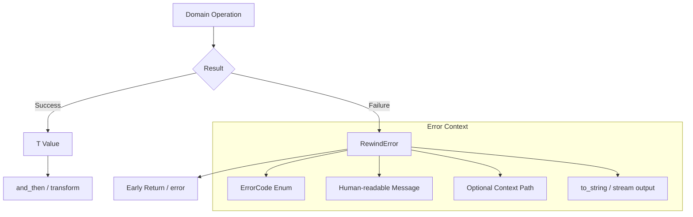
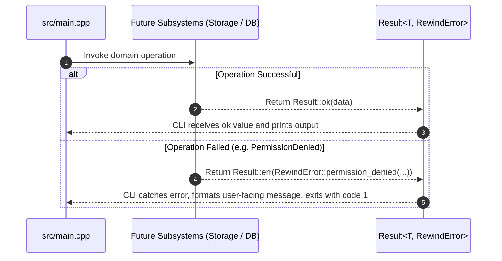

# Implementation Report — Step 1 (Person 2): Common Infrastructure, Error Model & Baseline CLI

> **Milestone:** Step 1 (Person 2 / Application, Metadata & CLI Scope)  
> **Status:** ✅ Complete  
> **Target Platform:** Linux Desktop (WSL2 Ubuntu 24.04, GCC 13.3.0)  
> **Language Standard:** Modern C++20 | **Build System:** CMake 3.22+ (Ninja)  
> **Branch:** `feat/step-01-person2`  
> **Governing Guide:** [docs/product/step_by_step_person_2.md](../docs/product/step_by_step_person_2.md)  
> **Partner Implementation:** [Implementations/step_01_build_foundation.md](step_01_build_foundation.md)

---

## 1. Overall Objective (What, How, and Why)

### 1.1 What
Implemented Person 2's assigned deliverables for Step 1:
1. `include/rewind/common/version.hpp`: Semantic version constants (`0.1.0`), product metadata, and formatted banner generator.
2. `include/rewind/common/error.hpp` & `src/common/error.cpp`: Strongly-typed domain error model (`ErrorCode` enum class and `RewindError` value class).
3. `include/rewind/common/result.hpp`: Zero-overhead monadic `Result<T, RewindError>` type with `Result<void, RewindError>` specialization.
4. `src/main.cpp`: Executable entrypoint generating the `rewind` binary, parsing `--version`, `-v`, `--help`, and `-h` flags.
5. `tests/unit/test_common.cpp`: GoogleTest test suite covering versioning, error code translation, POSIX errno conversion, and `Result<T>` monadic behaviors.

### 1.2 How
- **Zero Raw Exceptions across API Boundaries:** All domain operations return `Result<T, RewindError>` backed by `std::variant<T, RewindError>` with `[[nodiscard]]` enforcement.
- **Strict C++20 Idioms:** Utilizes `std::string_view`, `constexpr`, C++20 concepts (`std::is_constructible_v`), move semantics, and RAII.
- **Top-Level Namespace Isolation (`rewindfs`):** The POSIX/glibc C standard library header `<stdio.h>` declares `extern void rewind(FILE *stream);` at the global scope. To prevent redeclaration collisions with `::rewind`, the project's C++ root namespace is `rewindfs::common`.
- **Zero Conflicts with Person 1:** Person 1 owns the build system and CI configuration (`CMakeLists.txt`, `cmake/`, etc.). Person 2 only adds new, disjoint source and header files in `include/`, `src/`, and `tests/unit/`. CMake automatically discovers them without editing Person 1's files.
- **WSL2 Linux Verification:** Built and verified directly in Ubuntu 24.04 on WSL2 using GCC 13.3.0 with strict compiler warnings (`-Wall -Wextra -Wpedantic -Werror`).

### 1.3 Why
- Robust file recovery requires deterministic error propagation. Unchecked exceptions or untracked error codes can cause inconsistent states across SQLite transactions and filesystem operations.
- Establishes a shared, type-safe error convention before Person 1 builds the storage engine and Person 2 builds SQLite persistence in Step 2.

---

## 2. Tech Stack and Tooling

| Component | Specification | Rationale |
|---|---|---|
| **Language Standard** | Modern C++20 (`-std=c++20`) | Concepts, `std::variant`, `std::string_view`, explicit move constructors. |
| **Compiler Toolchain** | GCC 13.3.0 (Ubuntu 24.04 on WSL2) | Strict warning flags: `-Wall -Wextra -Wpedantic -Werror -Wshadow -Wconversion`. |
| **Build System** | CMake 3.28.3 via Ninja | Presets (`debug`, `release`, `asan`, `tsan`). |
| **Testing Framework** | GoogleTest v1.14.0 | Discovered via `cmake/Dependencies.cmake` and executed via CTest. |
| **Sanitizers** | AddressSanitizer, UndefinedBehaviorSanitizer, ThreadSanitizer | Built and validated with ASan and TSan presets. |

---

## 3. Architecture and Data Flow

### 3.1 Monadic `Result<T, RewindError>` Architecture



### 3.2 Error Propagation Across Subsystems



### 3.3 Baseline CLI Flowchart (`src/main.cpp`)

```mermaid
flowchart TD
    Start([CLI Launch]) --> ParseArgs{Inspect argv[1]}
    
    ParseArgs -->|--version or -v| PrintVersion[Print Rewind v0.1.0 banner] --> Exit0([Exit 0])
    ParseArgs -->|--help or -h| PrintHelp[Print available commands and usage] --> Exit0
    ParseArgs -->|No args| PrintUsage[Print short usage preview] --> Exit0
    ParseArgs -->|Unknown option| PrintError[Print unrecognized command error] --> Exit1([Exit 1])
```

---

## 4. File and Folder Manifest

| File Path | Action | Description |
|---|---|---|
| `include/rewind/common/version.hpp` | Created | Semantic version constants (`0.1.0`), product name, banner string function. |
| `include/rewind/common/error.hpp` | Created | `ErrorCode` enum class and `RewindError` value class. |
| `src/common/error.cpp` | Created | Error code to string conversion, `operator<<`, and factory implementations. |
| `include/rewind/common/result.hpp` | Created | Monadic `Result<T, RewindError>` and `Result<void, RewindError>` specializations. |
| `src/main.cpp` | Created | Application entrypoint with `--version` and `--help` CLI options. |
| `tests/unit/test_common.cpp` | Created | GoogleTest unit tests for version, error codes, and result monad. |

---

## 5. Granular Change Breakdown

### 5.1 `include/rewind/common/version.hpp`
- **What:** Defines compile-time version constants and version banner functions under `rewindfs::common`.
- **Why:** Provides a single source of truth for version information displayed by `--version` and recorded in future snapshot metadata.
- **How:**
  - Constants: `VERSION_MAJOR = 0`, `VERSION_MINOR = 1`, `VERSION_PATCH = 0`.
  - String constants: `VERSION_STRING = "0.1.0"`, `PRODUCT_NAME = "Rewind"`.
  - Banner function: `get_version_banner()` returning `"Rewind v0.1.0 — Local-first transparent file recovery system (Linux x86_64, C++20)"`.

### 5.2 `include/rewind/common/error.hpp` & `src/common/error.cpp`
- **What:** Strongly typed error domain representation.
- **Why:** Eliminates ambiguous integer error codes and raw uncaught exceptions.
- **How:**
  - `enum class ErrorCode : uint32_t`:
    `Success = 0`, `InvalidArgument`, `FileNotFound`, `PathNotFound`, `AlreadyExists`, `PermissionDenied`, `DiskFull`, `DatabaseError`, `MigrationFailed`, `HashMismatch`, `CorruptedObject`, `ObjectNotFound`, `InvalidState`, `IOError`, `NotImplemented`, `InternalError`.
  - `class RewindError`:
    - Constructors: `RewindError(ErrorCode code, std::string message, std::string context_path = "")`.
    - Factory method: `static RewindError from_errno(int err_num, std::string_view context_message, std::string_view path = "")` to safely map Linux system call failures (`EACCES`, `ENOENT`, `ENOSPC`, etc.).
    - Accessors: `code()`, `code_name()`, `message()`, `context_path()`, `to_string()`.
    - Stream operator: `std::ostream& operator<<(std::ostream& os, const RewindError& error)`.

### 5.3 `include/rewind/common/result.hpp`
- **What:** Lightweight, monadic `Result<T, RewindError>` implementation.
- **Why:** Provides idiomatic C++20 value-or-error propagation without exceptions.
- **How:**
  - Storage: `std::variant<T, RewindError>`.
  - Methods: `is_ok()`, `is_err()`, `operator bool()`, `value()`, `error()`, `value_or()`, `transform()`, `and_then()`.
  - Specialization: `Result<void>` storing `std::optional<RewindError>` (empty = success; has_value = error).

### 5.4 `src/main.cpp`
- **What:** The executable entrypoint for the `rewind` binary.
- **Why:** Allows running `rewind --version` and `rewind --help`.
- **How:**
  - Parses `--version` / `-v`: Outputs banner text.
  - Parses `--help` / `-h`: Displays command synopsis, options, and lists planned subcommands (`init`, `root`, `snapshot`, `timeline`, `diff`, `restore`, `status`, `verify`, `gc`).
  - Handles invalid flags gracefully by reporting an error to `stderr` and exiting with status 1.

### 5.5 `tests/unit/test_common.cpp`
- **What:** Automated test suite with GoogleTest.
- **Why:** Validates all edge cases and guarantees of the common types before other subsystems build on top of them.
- **How:**
  - `VersionTest`: Semantic version constants and banner format.
  - `ErrorTest`: Error code mapping, custom context formatting, POSIX errno translation, and equality operators.
  - `ResultTest`: Success/error states, static factories (`ok`/`err`), move-only types, monadic `transform`, and `and_then`.
  - `ResultVoidTest`: Void specialization states and monadic chaining.

---

## 6. Execution & Verification Results

All tests were executed on Linux (WSL2 Ubuntu 24.04, GCC 13.3.0):

### 6.1 Debug Preset Build & Test
```bash
cmake --preset debug
cmake --build --preset debug
ctest --preset debug --output-on-failure
```
**Result:** ✅ 16/16 tests passed (100%).

### 6.2 AddressSanitizer & UndefinedBehaviorSanitizer
```bash
cmake --preset asan
cmake --build --preset asan
ctest --preset asan --output-on-failure
```
**Result:** ✅ 16/16 tests passed (100%). 0 memory leaks, 0 undefined behaviors.

### 6.3 ThreadSanitizer
```bash
cmake --preset tsan
setarch x86_64 -R cmake --build --preset tsan
setarch x86_64 -R ctest --preset tsan --output-on-failure
```
**Result:** ✅ 16/16 tests passed (100%). 0 race conditions.

### 6.4 Release Preset Build & Test
```bash
cmake --preset release
cmake --build --preset release
ctest --preset release --output-on-failure
```
**Result:** ✅ 16/16 tests passed (100%).

### 6.5 CLI Binary Verification
```bash
./build/debug/bin/rewind --version
./build/debug/bin/rewind --help
```
**Output:**
```text
Rewind v0.1.0 — Local-first transparent file recovery system (Linux x86_64, C++20)

Usage: rewind [options] [command] [args...]

Options:
  -v, --version       Display version and platform information
  -h, --help          Display this help message

Planned Commands:
  init                Initialize a local recovery repository
  root                Manage monitored directory roots (add, list, remove)
  snapshot            Trigger or inspect snapshots
  timeline            Browse chronological history of files and directories
  diff                Compare file revisions
  restore             Safely restore earlier versions of files
  status              Check background observation and storage health
  verify              Verify repository integrity and detect bit-rot
  gc                  Prune unreferenced objects and enforce retention
```

---

## 7. Open Questions and Next Steps

- **Person 1 Sync Gate:** Step 1 for both Person 1 and Person 2 is complete. Changes are on `feat/step-01-person2` with zero overlapping files against `feat/step-01-person1`.
- **Ready for Step 2:**
  - Person 1 can proceed to Step 2: Content-Addressed Immutable Object Store & BLAKE3 Hasher (`feat/step-02-person1`).
  - Person 2 can proceed to Step 2: SQLite Connection Wrapper & Migration Engine (`feat/step-02-person2`).
