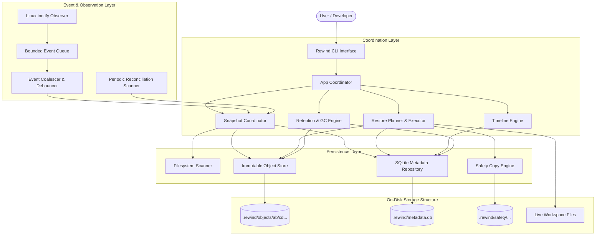
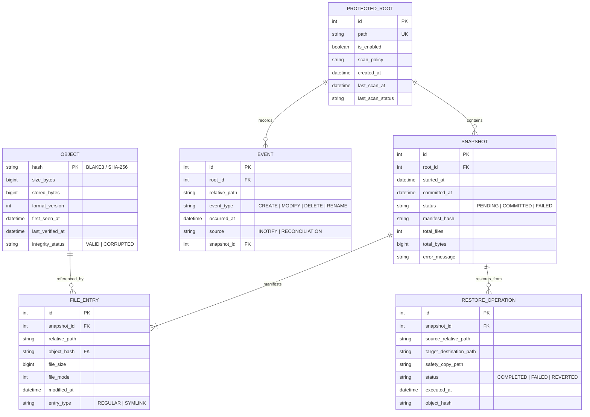
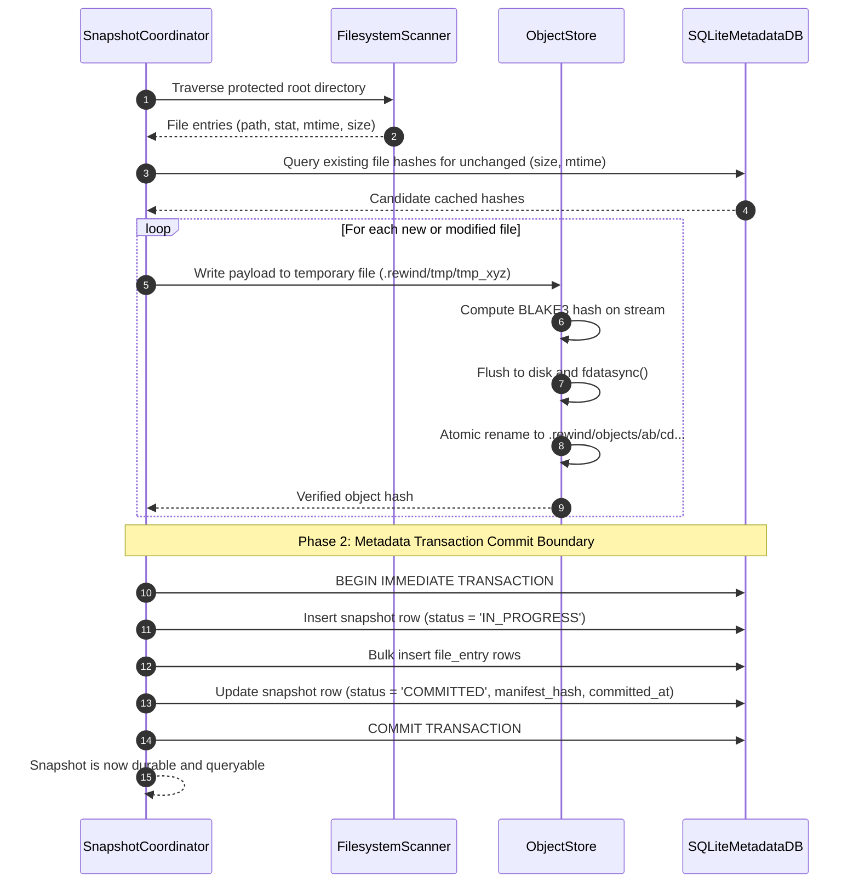
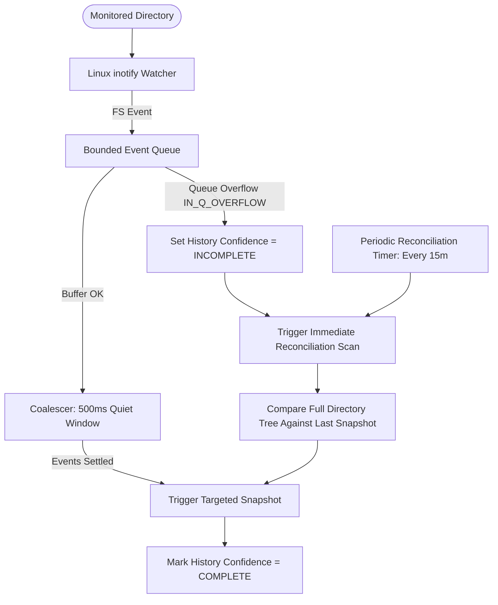

# Rewind — Master Implementation Plan

> **Document Type:** Master Architectural Blueprint & Implementation Specification  
> **Status:** Baseline Plan · **Version:** 1.0 · **Date:** 2026-10-13  
> **Target Platform:** Linux Desktop (x86_64, aarch64) · **Language Standard:** C++20  
> **Derived Documents:** [step_by_step_guide.md](product/step_by_step_guide.md), [step_by_step_person_1.md](product/step_by_step_person_1.md), [step_by_step_person_2.md](product/step_by_step_person_2.md), `progress_tracker.md`

---

## 1. Executive Summary & Objective

### 1.1 What Is Being Built
Rewind is a lightweight, local-first file recovery system designed for Linux desktop. It continuously and transparently maintains historical versions of user-selected directories, stores deduplicated file contents as immutable objects, tracks recovery metadata in an ACID-compliant SQLite database, and provides safe, verified file-level restores with zero chance of damaging existing workspace content.

### 1.2 How It Will Be Built
The system is architected as a decoupled modular monolith in modern C++20:
- **Storage Subsystem:** Implements an immutable, content-addressed store indexed by cryptographic hashes (BLAKE3 or SHA-256) across a two-level sharded directory structure (`.rewind/objects/ab/cd...`).
- **Metadata Subsystem:** Uses SQLite 3 in Write-Ahead Logging (WAL) mode to record snapshots, file manifests, and change events transactionally.
- **Commit Protocol:** Follows a strict two-phase commit ordering: raw object files are flushed and synced to disk before any snapshot metadata manifest references them.
- **Observer Subsystem:** Combines Linux kernel filesystem notifications (`inotify`) with an event-coalescing queue and a periodic reconciliation scanner to overcome OS event drops and buffer overflows.
- **Restore Subsystem:** Executes a multi-step verified restore protocol: candidate bytes are staged to a temporary file, content hash is re-verified, a timestamped safety copy of any existing destination file is created, and the restored file is published via atomic rename.

### 1.3 Why It Is Being Built
Developers, researchers, students, and writers frequently lose valuable work due to accidental deletions, destructive script executions, bad regex replacements, or bad cleanup commands. Existing backup tools often require cloud accounts, remote infrastructure, or complex setup, while version control systems like Git only protect files that are explicitly staged and committed. Rewind provides an automatic local workspace safety net that operates silently, stays 100% offline, preserves privacy, and guarantees that restoring a past file never destroys newer work.

---

## 2. Technology Stack & Toolchain

| Layer / Component | Technology / Standard | Rationale / Justification |
|---|---|---|
| **Core Language** | Modern C++20 | Zero-cost abstractions, RAII, `std::span`, `std::string_view`, concepts, and strong value semantics for high-performance systems engineering. |
| **Build System** | CMake 3.22+ | Industry-standard C++ build orchestrator with native `CMakePresets.json` support for reproducible build configurations across environments. |
| **Compiler Toolchain** | GCC 13+ / Clang 17+ | Full C++20 conformance, robust diagnostic warnings, and first-class sanitizer support. |
| **Persistence Engine** | SQLite 3.40+ | Serverless, zero-configuration, transactional ACID metadata store with WAL mode for concurrent snapshot reads and writes. |
| **Content Hashing** | BLAKE3 (fallback: SHA-256) | Cryptographically secure, ultra-fast hashing (>3 GB/s per core) ensuring high-throughput content-addressing and deduplication. |
| **OS APIs (Linux)** | `inotify`, `renameat2`, `fsync`, `fdatasync`, `O_TMPFILE` | Direct kernel system calls for filesystem event notification, race-free directory operations, and crash-resilient atomic file publication. |
| **Test Framework** | GoogleTest (GTest) & CTest | Comprehensive assertion framework supporting unit tests, parameterized tests, and structured test runners. |
| **Static & Dynamic Analysis** | Clang-Tidy, Clang-Format, ASan, UBSan, TSan | Strict compile-time and runtime validation to eliminate memory leaks, undefined behavior, race conditions, and formatting drift. |
| **Packaging & Init** | CPack (.deb, .rpm), Systemd User Units | Native Linux packaging and background daemon process supervision without custom daemons. |

---

## 3. Visual Architecture & Workflow Models

### 3.1 Subsystem Architecture & Data Flow



### 3.2 Entity-Relationship Diagram (ERD) — SQLite Schema



### 3.3 Snapshot Commit Protocol (Two-Phase State Machine)



### 3.4 Multi-Step Restore Safety Protocol

```mermaid
sequenceDiagram
    autonumber
    participant User as User / CLI
    participant Planner as RestorePlanner
    participant Store as ObjectStore
    participant FS as Live Filesystem
    participant DB as SQLiteMetadataDB

    User->>Planner: Request restore(snapshot_id, file_path, destination)
    Planner->>Metadata: Query file_entry for snapshot_id and path
    Metadata-->>Planner: Target object_hash and file metadata
    
    Planner->>Store: Stream object payload to temporary staging file
    Planner->>Planner: Re-calculate hash of staged file
    alt Hash mismatch
        Planner-->>User: ABORT: Object corrupted; live file untouched
    end

    alt Destination file currently exists
        Planner->>FS: Copy existing destination to .rewind/safety/timestamp_filename
        FS-->>Planner: Safety copy secured
        Planner->>DB: Log safety copy path in restore_operation
    end

    Planner->>FS: Atomic replace destination with staged file
    Planner->>DB: Record restore_operation (status = 'COMPLETED')
    Planner-->>User: SUCCESS: File restored safely with rollback point
```

### 3.5 Observer & Reconciliation Engine



---

## 4. Repository Structure & File Manifest

The codebase follows the strict domain structure defined in PRD Section 12:

```text
rewind/
├── README.md
├── LICENSE
├── CONTRIBUTING.md
├── CODE_OF_CONDUCT.md
├── SECURITY.md
├── CHANGELOG.md
├── CMakeLists.txt
├── CMakePresets.json
├── .clang-format
├── .clang-tidy
├── .editorconfig
├── .gitignore
├── .github/
│   └── workflows/
│       ├── build.yml
│       ├── test.yml
│       ├── sanitizers.yml
│       ├── benchmark-smoke.yml
│       └── wiki-sync.yml
├── cmake/
│   ├── CompilerWarnings.cmake
│   ├── Sanitizers.cmake
│   └── Dependencies.cmake
├── docs/
│   ├── full_implementation_plan.md
│   ├── product/
│   │   ├── PRD.md
│   │   ├── project_implementation_guidelines.md
│   │   ├── personas-and-jobs.md
│   │   ├── competitive-research.md
│   │   ├── user-interview-plan.md
│   │   └── ux-flows.md
│   ├── architecture/
│   │   ├── overview.md
│   │   ├── invariants.md
│   │   ├── data-model.md
│   │   ├── snapshot-commit-protocol.md
│   │   ├── restore-protocol.md
│   │   ├── retention-and-gc.md
│   │   └── decisions/
│   │       ├── 0001-linux-first.md
│   │       ├── 0002-sqlite-metadata.md
│   │       ├── 0003-immutable-objects.md
│   │       ├── 0004-event-plus-reconciliation.md
│   │       └── 0005-hash-before-chunking.md
│   ├── security/
│   │   ├── threat-model.md
│   │   ├── privacy.md
│   │   └── recovery-limits.md
│   ├── testing/
│   │   ├── test-strategy.md
│   │   ├── crash-matrix.md
│   │   └── benchmark-method.md
│   └── research/
│       └── competitor-test-results.md
├── wiki/
│   ├── Home.md
│   ├── ARCHITECTURE.md
│   ├── DATABASE.md
│   ├── CLI_AND_API.md
│   ├── STORAGE_AND_INTEGRITY.md
│   ├── RESTORE_AND_SAFETY.md
│   ├── OBSERVER_AND_RECONCILIATION.md
│   ├── TESTING.md
│   ├── DEPLOYMENT.md
│   └── UML.md
├── include/
│   └── rewind/
│       ├── app/
│       │   ├── app_coordinator.hpp
│       │   └── context.hpp
│       ├── common/
│       │   ├── error.hpp
│       │   ├── result.hpp
│       │   ├── types.hpp
│       │   └── version.hpp
│       ├── config/
│       ├── domain/
│       │   ├── file_entry.hpp
│       │   ├── object_id.hpp
│       │   ├── protected_root.hpp
│       │   └── snapshot.hpp
│       ├── filesystem/
│       │   ├── path_sanitizer.hpp
│       │   ├── scanner.hpp
│       │   └── traversal_policy.hpp
│       ├── observer/
│       │   ├── coalescer.hpp
│       │   ├── event.hpp
│       │   └── inotify_watcher.hpp
│       ├── snapshot/
│       │   ├── commit_protocol.hpp
│       │   └── snapshot_coordinator.hpp
│       ├── storage/
│       │   ├── hasher.hpp
│       │   ├── object_store.hpp
│       │   └── storage_layout.hpp
│       ├── metadata/
│       │   ├── database.hpp
│       │   ├── migration_runner.hpp
│       │   └── repositories.hpp
│       ├── restore/
│       │   ├── conflict_resolver.hpp
│       │   ├── restore_executor.hpp
│       │   └── restore_planner.hpp
│       ├── retention/
│       │   ├── garbage_collector.hpp
│       │   └── retention_policy.hpp
│       ├── timeline/
│       │   ├── diff_engine.hpp
│       │   └── timeline_query.hpp
│       └── platform/
│           ├── file_ops.hpp
│           └── linux_primitives.hpp
├── src/
│   ├── app/
│   │   ├── app_coordinator.cpp
│   │   └── context.cpp
│   ├── config/
│   ├── domain/
│   ├── filesystem/
│   │   ├── path_sanitizer.cpp
│   │   └── scanner.cpp
│   ├── observer/
│   │   ├── coalescer.cpp
│   │   ├── inotify_watcher.cpp
│   │   └── linux/
│   ├── snapshot/
│   │   ├── commit_protocol.cpp
│   │   └── snapshot_coordinator.cpp
│   ├── storage/
│   │   ├── hasher.cpp
│   │   ├── object_store.cpp
│   │   └── storage_layout.cpp
│   ├── metadata/
│   │   ├── database.cpp
│   │   ├── migration_runner.cpp
│   │   └── repositories.cpp
│   ├── restore/
│   │   ├── conflict_resolver.cpp
│   │   ├── restore_executor.cpp
│   │   └── restore_planner.cpp
│   ├── retention/
│   │   ├── garbage_collector.cpp
│   │   └── retention_policy.cpp
│   ├── timeline/
│   │   ├── diff_engine.cpp
│   │   └── timeline_query.cpp
│   ├── platform/
│   │   └── linux/
│   │       └── file_ops.cpp
│   ├── cli/
│   │   ├── cli_parser.hpp
│   │   ├── cli_parser.cpp
│   │   ├── commands.hpp
│   │   └── commands.cpp
│   ├── common/
│   │   └── error.cpp
│   └── main.cpp
├── migrations/
│   └── sqlite/
│       ├── 001_initial_schema.sql
│       └── 002_add_restore_audit.sql
├── tests/
│   ├── unit/
│   │   ├── test_hasher.cpp
│   │   ├── test_object_store.cpp
│   │   ├── test_path_sanitizer.cpp
│   │   ├── test_coalescer.cpp
│   │   └── test_metadata.cpp
│   ├── integration/
│   │   ├── test_snapshot_lifecycle.cpp
│   │   ├── test_safe_restore.cpp
│   │   └── test_reconciliation.cpp
│   ├── crash/
│   │   ├── test_commit_boundary_crash.cpp
│   │   └── test_restore_interruption.cpp
│   ├── security/
│   │   ├── test_symlink_traversal.cpp
│   │   └── test_path_escape.cpp
│   ├── fixtures/
│   └── support/
├── tools/
│   ├── workload_generator/
│   ├── benchmark_runner/
│   │   └── benchmark_main.cpp
│   ├── crash_injector/
│   │   └── injector_main.cpp
│   └── store_inspector/
├── examples/
│   ├── sample-config.toml
│   └── demo-workspace/
├── Implementations/
│   └── (Archived completed implementation plans)
└── packaging/
    └── linux/
        ├── rewind.service
        └── control
```

---

## 5. Phase-by-Phase Implementation Blueprint

### Phase 0: Problem Validation & Baseline Requirements
- **What:** Validate core user jobs, recovery pain points, and benchmark target workloads with test directory trees.
- **Why:** Ensure that architectural decisions (such as whole-file vs. chunked objects, debouncing windows, and metadata fields) match realistic usage patterns.
- **How:** Create representative file datasets (source code repositories, text drafts, structured project folders) to drive automated benchmarks and test suites.

### Phase 1: Build Foundation, Toolchains & CI
- **What:** Configure root CMake structure, compiler warnings, static analyzers, sanitizer presets, and GitHub Actions CI.
- **Why:** Establish zero-warning baseline, reproducible developer builds, and automated regression testing before implementing core domain code.
- **How:**
  - Create `CMakeLists.txt`, `CMakePresets.json`, `cmake/CompilerWarnings.cmake`, `cmake/Sanitizers.cmake`.
  - Implement common primitives: `Result<T, Error>`, `RewindError`, version constants, and minimal CLI with `--version` and `--help`.
  - Add GitHub Actions CI workflow building on Ubuntu with GCC and Clang.

### Phase 2: Content-Addressed Immutable Object Store
- **What:** Build the storage engine that writes, hashes, stores, and verifies immutable content objects.
- **Why:** Guarantee content integrity, data immutability, and natural deduplication of unmodified files.
- **How:**
  - Integrate cryptographic hasher (BLAKE3 with fallback to standard SHA-256).
  - Implement streaming writes to temporary files in `.rewind/tmp/`.
  - Publish objects via atomic rename into sharded directory paths (`.rewind/objects/ab/cd...`).
  - Implement read verification and unit tests covering disk-full simulations, partial writes, and corrupted file detection.

### Phase 3: SQLite Metadata Schema & Snapshot Commit Engine
- **What:** Implement the SQLite persistence layer and the transactional snapshot commit state machine.
- **Why:** Ensure snapshot manifests, file entries, and root configurations are committed with strict ACID guarantees.
- **How:**
  - Create SQLite database wrapper (`metadata/database.cpp`) with WAL mode, foreign keys, and busy handlers.
  - Implement migration runner executing `migrations/sqlite/*.sql`.
  - Implement repositories for `protected_root`, `snapshot`, `file_entry`, `object`.
  - Implement `SnapshotCoordinator` enforcing the two-phase commit: all object files must be durable before committing SQLite snapshot manifest.
  - Test crash injection at the commit boundary.

### Phase 4: Safe Directory Traversal & Manual Snapshotting
- **What:** Implement safe filesystem scanning, symlink policies, permission recording, and manual CLI snapshots.
- **Why:** Enable users to scan configured folders and create verifiable recovery points on demand.
- **How:**
  - Build `PathSanitizer` preventing directory traversal outside root boundaries.
  - Implement `FilesystemScanner` handling large trees, permissions, and files that change during scan.
  - Expose CLI subcommands: `rewind root add/list/remove`, `rewind snapshot create/list/inspect`.

### Phase 5: Verified Multi-Step Restore Protocol & Safety Copies
- **What:** Implement the safe restore planner and executor with collision prevention, safety copies, and undo support.
- **Why:** Fulfill Rewind's core promise that restoring a past file never destroys existing valid files.
- **How:**
  - Implement `RestorePlanner`: validates target destination, detects conflicts, and stages bytes to temporary file.
  - Verify staged content hash before touching the live filesystem.
  - Automatically preserve existing destination files to `.rewind/safety/`.
  - Atomically replace target destination using POSIX atomic rename.
  - Log restore audit to SQLite `restore_operation` and provide undo command (`rewind restore --undo`).

### Phase 6: Automatic Linux Inotify Observer & Reconciliation
- **What:** Implement real-time Linux filesystem monitoring with debounced event coalescing and periodic reconciliation.
- **Why:** Capture file modifications transparently without manual user intervention while safely handling OS event drops.
- **How:**
  - Build `InotifyWatcher` wrapping Linux `inotify_init1()` and recursive directory watch descriptors.
  - Implement `EventCoalescer` buffering events in a bounded queue and applying a 500ms quiet window.
  - Implement periodic background reconciliation scanner that compares disk state with last snapshot to handle missed events.

### Phase 7: Timeline Engine, Diff Generator & Usable CLI
- **What:** Build timeline inspection, chronological history queries, file diffing, and friendly CLI status presentations.
- **Why:** Allow users to quickly answer: "What changed? When? Can I preview it before restoring?"
- **How:**
  - Build `TimelineEngine` querying SQLite file events and snapshot revisions.
  - Implement bounded text diff generator for text files.
  - Expose `rewind timeline`, `rewind diff`, and `rewind status` with both human-readable and `--json` outputs.

### Phase 8: Retention Engine & Reachability Garbage Collection
- **What:** Implement retention policies (age-based, count-based) and safe mark-and-sweep garbage collection.
- **Why:** Prevent unbounded disk usage while strictly ensuring no object referenced by an active snapshot is ever pruned.
- **How:**
  - Build `RetentionPolicy` evaluating snapshot pruning candidates.
  - Implement reachability analysis: traverse all committed snapshot manifests and mark active object hashes.
  - Prune unreferenced objects only after grace periods. Provide dry-run mode (`rewind gc --dry-run`).

### Phase 9: Security Hardening, Sanitizers & Packaging
- **What:** Run full security reviews, sanitizer sweeps (ASan, UBSan, TSan), fuzzing, and build Linux packages.
- **Why:** Ensure production reliability, unprivileged execution safety, and straightforward installation.
- **How:**
  - Audit path validation, permission handling, and error leakages.
  - Generate CPack deb/rpm packages and systemd user service (`packaging/linux/rewind.service`).

### Phase 10: Optional Encrypted Peer-to-Peer Device Replication
- **What:** Implement optional, opt-in network replication to a secondary trusted machine.
- **Why:** Protect against local hardware failure without relying on commercial cloud accounts.
- **How:**
  - Standard TLS/crypto transport with mutual peer authentication.
  - Resumable object streaming with verified acknowledgments.

### Phase 11: Cross-Platform Expansion
- **What:** Abstract OS primitives and implement platform backends for macOS (FSEvents) and Windows (ReadDirectoryChangesW).
- **Why:** Expand Rewind to developers and creators on all major desktop operating systems.
- **How:**
  - Isolate OS-specific notification and atomic replace primitives behind `platform/` interfaces.
  - Implement and test backends individually with platform-specific CI suites.

---

## 6. User Execution & Verification Instructions

### 6.1 Toolchain Setup & Dependencies

**Ubuntu / Debian:**
```bash
sudo apt-get update
sudo apt-get install -y build-essential cmake ninja-build libsqlite3-dev pkg-config
```

**Fedora / RHEL:**
```bash
sudo dnf install -y gcc-c++ cmake ninja-build sqlite-devel
```

**Arch Linux:**
```bash
sudo pacman -S base-devel cmake ninja sqlite
```

### 6.2 Build & Execution Commands
```bash
# Clone and enter directory
git clone https://github.com/Swar-16/Rewind.git
cd Rewind

# Configure debug build
cmake --preset debug

# Compile all targets
cmake --build --preset debug -j$(nproc)

# Run full test suite with verbose failure reporting
ctest --preset debug --output-on-failure
```

### 6.3 Verification with Clang Sanitizers
```bash
# AddressSanitizer & UndefinedBehaviorSanitizer
cmake --preset asan
cmake --build --preset asan -j$(nproc)
ctest --preset asan --output-on-failure

# ThreadSanitizer (Concurrency validation)
cmake --preset tsan
cmake --build --preset tsan -j$(nproc)
ctest --preset tsan --output-on-failure
```

### 6.4 CLI Operational Workflow Preview
```bash
# Initialize storage
./build/debug/bin/rewind init --store-path ~/.local/share/rewind

# Monitor a directory
./build/debug/bin/rewind root add ~/projects/my_project

# Query system status
./build/debug/bin/rewind status

# Run manual snapshot
./build/debug/bin/rewind snapshot create

# Inspect historical timeline for a specific file
./build/debug/bin/rewind timeline ~/projects/my_project/src/main.cpp

# Restore previous version safely
./build/debug/bin/rewind restore ~/projects/my_project/src/main.cpp --snapshot 1
```

---

## 7. Open Questions & Architectural Decisions (ADRs)

| Decision Area | Proposed Approach | Alternative Considered | Rationale |
|---|---|---|---|
| **Content Chunking** | Whole-file objects for MVP | FastCDC / Rabin content-defined chunking | Whole-file objects eliminate index complexity and metadata bloat; chunking will be benchmarked in Phase 8 to evaluate if real workloads warrant it. |
| **Notification API** | Linux `inotify` | Linux `fanotify` | `inotify` operates unprivileged without requiring `root` or `CAP_SYS_ADMIN` privileges, making it accessible for desktop user applications. |
| **Metadata Engine** | SQLite 3 (WAL mode) | Embedded Key-Value (RocksDB / LMDB) | SQLite provides rich SQL querying for timeline filters, relational foreign keys, robust transactional rollback, and battle-tested crash durability. |
| **Process Model** | Modular Monolith + CLI/Daemon mode | Multi-process client/server daemon | Single binary with optional daemon mode simplifies packaging, memory footprint, testing, and avoids IPC protocol complexity during initial phases. |

---

## 8. Testing, Quality & Deployment Details

### 8.1 Automated Test Pyramid
1. **Unit Tests (80%+ coverage):** Fast, in-memory tests covering hashing, path parsing, coalescing math, SQLite migrations, and manifest serialization.
2. **Integration Tests:** Filesystem fixture tests creating actual files, modifying contents, running snapshots, and performing safe restores.
3. **Crash Injection Tests:** Simulated process termination right before, during, and after persistence boundaries to prove recovery points remain valid.
4. **Security Tests:** Path traversal attack suites, symlink loop detection, and unprivileged user isolation checks.
5. **Benchmarks:** Standardized test suites measuring idle memory (<50 MiB), idle CPU (~0%), snapshot capture latency, and restore throughput.

### 8.2 Deployment & Service Supervision
- Systemd user service (`~/.config/systemd/user/rewind.service`) enables automatic background monitoring upon login.
- CPack generates clean `.deb` and `.rpm` packages containing the binary, systemd unit, and man pages.

---

## 9. Final Operational Q&A & Edge Cases

**Q: What happens if a file is modified while Rewind is reading it?**  
*A:* Rewind compares the file's modification time and size before and after reading. If a concurrent write is detected during capture, the candidate object is discarded, and the file is re-queued for the next quiet cycle.

**Q: What happens if disk space runs out during a snapshot?**  
*A:* The streaming write to `tmp/` fails with an explicit `ENOSPC` error. The partial file in `tmp/` is unlinked, the SQLite transaction is aborted, and the snapshot is marked as `FAILED`. No corrupted snapshot is ever committed.

**Q: How does Rewind handle symlinks?**  
*A:* Symlinks are stored as symbolic link manifests (recording the link target path) rather than traversed blindly. Rewind never follows symlinks outside the monitored root boundary, preventing path traversal vulnerabilities.

**Q: Can restoring an older version destroy uncommitted new work?**  
*A:* Never. If the destination file already exists, Rewind creates a verified, timestamped safety copy in `.rewind/safety/` before atomically replacing the file. The operation can be undone via `rewind restore --undo`.

---

## 10. Roadmap Integration

This document (`full_implementation_plan.md`) serves as the master technical blueprint for the repository:
1. **[step_by_step_guide.md](product/step_by_step_guide.md)** translates this master plan into a chronological sequence of bite-sized engineering steps across 10 milestones.
2. **[step_by_step_person_1.md](product/step_by_step_person_1.md)** and **[step_by_step_person_2.md](product/step_by_step_person_2.md)** divide the workload cleanly between two engineers with 100% disjoint file ownership to prevent merge conflicts.
3. **`progress_tracker.md`** tracks the status of each phase and task against this plan.
4. As each milestone is implemented, completed plans will be archived in `Implementations/`, and the Wiki pages in `wiki/` (`ARCHITECTURE.md`, `DATABASE.md`, etc.) will be progressively populated.
