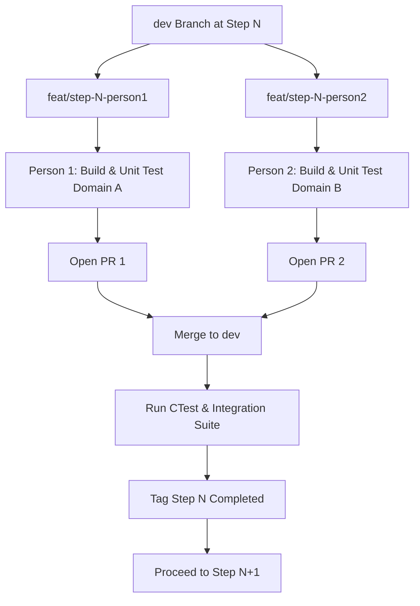

# Rewind — Master Step-by-Step Implementation Guide

> **Document Type:** Master Multi-Developer Execution Roadmap  
> **Status:** Active Baseline · **Version:** 1.0 · **Date:** 2026-10-13  
> **Target Platform:** Linux Desktop (x86_64, aarch64) · **Language Standard:** C++20  
> **Collaborator Workflows:** [step_by_step_person_1.md](step_by_step_person_1.md), [step_by_step_person_2.md](step_by_step_person_2.md)  
> **Governing Blueprint:** [docs/full_implementation_plan.md](../full_implementation_plan.md)

---

## 1. Overview & Collaboration Model

This document translates the master architecture from `docs/full_implementation_plan.md` into a sequential, multi-developer engineering roadmap. The project is structured across **10 discrete implementation steps**.

### 1.1 Two-Developer Conflict-Free Parallel Workflow
To allow two engineers (Person 1 and Person 2) to work concurrently without merge conflicts:
1. **Architectural Decoupling:** Subsystems are assigned strictly by domain:
   - **Person 1 (Systems & Storage Engineer):** Focuses on low-level POSIX primitives, cryptographic hashing, content-addressed object store, safe directory traversal, and Linux `inotify` observation.
   - **Person 2 (Metadata & Application Engineer):** Focuses on SQLite database persistence, relational schemas, migrations, restore planning, safety copy management, timeline queries, and CLI subcommands.
2. **Disjoint File Ownership:** At no point in any step do both developers edit the same file. Headers, implementations, and unit test suites are kept strictly separate.
3. **Step-by-Step Merge Gate Protocol:**
   - Both engineers branch off `dev` at the start of each step:
     - Person 1 branch: `feat/step-XX-person1`
     - Person 2 branch: `feat/step-XX-person2`
   - During the step, each developer implements their assigned components and verifies their isolated unit tests.
   - At the conclusion of the step, Person 1 and Person 2 review each other's work, merge their branches into `dev`, run the combined integration test suite, and verify a clean build.
   - Neither developer advances to Step N+1 until Step N is fully integrated and tested on `dev`.

---

## 2. Master Step Matrix

| Step | Milestone Name | Status | Person 1 Focus (Systems & Storage) | Person 2 Focus (Metadata & Applications) | Integration Deliverable |
|---|---|---|---|---|---|
| **Step 1** | Build Foundation & Toolchains | 🟢 Completed | CMake root, compiler warnings, sanitizers, CI workflow | Common types (`Result`, `Error`), version constants, baseline CLI skeleton | Clean build, GCC 13+ & Clang 17+ CI passing |
| **Step 2** | Core Storage & Database Setup | ❌ Not Started | BLAKE3 cryptographic hasher, temporary write & atomic publish | SQLite connection wrapper, WAL mode, migration engine | Durable object store + migrating SQLite DB |
| **Step 3** | Snapshot Coordinator & Metadata Repositories | ❌ Not Started | Commit protocol state machine & object durability flush | SQLite repository tables (`protected_root`, `snapshot`, `file_entry`) | End-to-end two-phase snapshot commit |
| **Step 4** | Filesystem Scanner & Manual Snapshots | ❌ Not Started | Path sanitizer, traversal policy, directory scanner | Root configuration CLI (`root add/list`), snapshot CLI (`snapshot create`) | Manual directory snapshot via CLI |
| **Step 5** | Verified Restore Safety & Safety Copies | ❌ Not Started | Pre-restore hash verification, staging temporary file, atomic replacer | Restore planner, conflict detector, safety copy manager, SQLite audit | Zero-data-loss verified file restore |
| **Step 6** | Observer, Coalescing & Reconciliation | ❌ Not Started | Linux `inotify` watcher, bounded queue, quiet-period debouncer | Periodic reconciliation scanner, history confidence evaluator | Background automatic change capture |
| **Step 7** | Timeline Queries, Diffing & Interactive CLI | ❌ Not Started | Bounded file diff generator (unified diffs for text files) | SQLite timeline query engine, CLI `timeline`, `diff`, `status` subcommands | Complete interactive CLI history browser |
| **Step 8** | Retention Policy & Safe Garbage Collection | ❌ Not Started | Reachability-based object garbage collector, dry-run pruning | Age/count retention evaluator, SQLite snapshot pruning | Bounded storage growth with crash safety |
| **Step 9** | Security Hardening & Benchmarks | ❌ Not Started | Path traversal security test suites, symlink jail tests | Crash-injection test harness, performance & memory benchmark suites | Security pass, ASan/UBSan/TSan verified |
| **Step 10** | Systemd Service, Packaging & Documentation | ❌ Not Started | Packaging specs (CPack deb/rpm), systemd user unit | Final wiki doc sync, sample configurations, end-to-end release smoke test | Production-ready distributable packages |

---

## 3. Step-by-Step Implementation Details

### Step 1: Build Foundation, Toolchains & Common Infrastructure [✅ Complete]
- **Objective:** Establish the CMake project, compiler warning baselines, sanitizer presets, CI pipelines, and shared core primitives.
- **Person 1 Responsibilities:**
  - Create root `CMakeLists.txt`, `cmake/CompilerWarnings.cmake`, `cmake/Sanitizers.cmake`, `cmake/Dependencies.cmake`.
  - Configure `CMakePresets.json` with debug, release, asan, and tsan configurations.
  - Create `.github/workflows/ci.yml` building on Ubuntu with GCC 13 and Clang 17.
  - Add `.clang-format` and `.clang-tidy` configurations.
- **Person 2 Responsibilities:**
  - Create `include/rewind/common/error.hpp` and `src/common/error.cpp` (`RewindError`, domain error codes).
  - Create `include/rewind/common/result.hpp` (`Result<T, Error>` monadic return type).
  - Create `include/rewind/common/version.hpp` and minimal `src/main.cpp` with `--version` and `--help` CLI parsing.
  - Create `tests/unit/test_common.cpp` verifying `Result` and error handling.
- **Merge & Verification Gate:**
  - Status: ✅ Complete across `debug`, `asan`, `tsan`, and `release` presets in WSL2 (Ubuntu 24.04).
  - Person 1 Report: [Implementations/step_01_build_foundation.md](../../Implementations/step_01_build_foundation.md)
  - Person 2 Report: [Implementations/step_01_common_infrastructure.md](../../Implementations/step_01_common_infrastructure.md)
  - Verification: Clean compilation with `-Wall -Wextra -Wpedantic -Werror`, 16/16 tests passing.

---

### Step 2: Content-Addressed Storage Engine & SQLite Database Setup
- **Objective:** Implement cryptographic content hashing, immutable object publishing, and the transactional SQLite metadata foundation.
- **Person 1 Responsibilities:**
  - Create `include/rewind/storage/hasher.hpp` and `src/storage/hasher.cpp` (BLAKE3 / SHA-256 streaming interface).
  - Create `include/rewind/storage/object_store.hpp` and `src/storage/object_store.cpp` (writing to `.rewind/tmp/`, atomic rename to `.rewind/objects/ab/cd...`, `fdatasync`).
  - Create `tests/unit/test_hasher.cpp` and `tests/unit/test_object_store.cpp` (testing deduplication, partial write cleanup, disk-full simulation).
- **Person 2 Responsibilities:**
  - Create `include/rewind/metadata/database.hpp` and `src/metadata/database.cpp` (RAII wrapper around `sqlite3*`, WAL mode, foreign keys).
  - Create `include/rewind/metadata/migration_runner.hpp` and `src/metadata/migration_runner.cpp`.
  - Create initial schema migration: `migrations/sqlite/001_initial_schema.sql` (`protected_root`, `snapshot`, `file_entry`, `object`).
  - Create `tests/unit/test_database.cpp` and `tests/unit/test_migrations.cpp`.
- **Merge & Verification Gate:**
  - Verify that Person 1's store can persist an object and Person 2's database can record a hash entry in a single test.
  - Run ASan preset: `cmake --preset asan && cmake --build --preset asan && ctest --preset asan`.

---

### Step 3: Snapshot Commit Coordinator & Database Repositories
- **Objective:** Bind object storage with database metadata using the strict two-phase commit protocol.
- **Person 1 Responsibilities:**
  - Create `include/rewind/snapshot/commit_protocol.hpp` and `src/snapshot/commit_protocol.cpp` (state machine: PREPARE, SYNC_OBJECTS, COMMIT_METADATA).
  - Create `include/rewind/snapshot/snapshot_coordinator.hpp` and `src/snapshot/snapshot_coordinator.cpp`.
  - Implement crash safety checks (guaranteeing that incomplete temporary writes are unlinked upon startup).
- **Person 2 Responsibilities:**
  - Create `include/rewind/metadata/repositories.hpp` and `src/metadata/repositories.cpp`:
    - `ProtectedRootRepository`: insert, update scan state, list active roots.
    - `SnapshotRepository`: insert pending snapshot, commit snapshot with manifest hash, query latest.
    - `FileEntryRepository`: bulk insert manifest records.
  - Create `tests/unit/test_repositories.cpp`.
- **Merge & Verification Gate:**
  - Run integration test: `tests/integration/test_snapshot_commit.cpp` simulating full snapshot creation and crash recovery.
  - Verify SQLite WAL checkpointing and foreign key integrity.

---

### Step 4: Filesystem Scanner, Path Sanitizer & Manual Snapshot CLI
- **Objective:** Traverse live directories safely and expose manual snapshot creation through the CLI.
- **Person 1 Responsibilities:**
  - Create `include/rewind/filesystem/path_sanitizer.hpp` and `src/filesystem/path_sanitizer.cpp` (prevents path escape outside root).
  - Create `include/rewind/filesystem/traversal_policy.hpp` (symlink policies, hidden file rules).
  - Create `include/rewind/filesystem/scanner.hpp` and `src/filesystem/scanner.cpp` (recursive traversal, stat recording, change detection via mtime/size).
  - Create `tests/unit/test_scanner.cpp`.
- **Person 2 Responsibilities:**
  - Create CLI parser in `src/cli/cli_parser.cpp` and subcommands in `src/cli/commands.cpp`:
    - `rewind init`: initialize `.rewind/` repository directory and run migrations.
    - `rewind root add <path>`, `rewind root list`, `rewind root remove <id>`.
    - `rewind snapshot create`: scan configured roots and execute commit coordinator.
    - `rewind snapshot list`: tabular output of completed recovery points.
  - Create `tests/unit/test_cli.cpp`.
- **Merge & Verification Gate:**
  - Run end-to-end CLI manual snapshot flow in a temporary test directory.
  - Verify that unmodified files reuse existing object hashes (deduplication verified).

---

### Step 5: Verified Multi-Step Restore Safety Engine & Safety Copies
- **Objective:** Implement safe file-level recovery with pre-restore hash verification and automated destination safety copies.
- **Person 1 Responsibilities:**
  - Create `include/rewind/platform/file_ops.hpp` and `src/platform/linux/file_ops.cpp` (POSIX atomic rename, temporary file staging, permissions preservation).
  - Create `include/rewind/restore/restore_executor.hpp` and `src/restore/restore_executor.cpp` (fetches object bytes, writes to staging file, verifies content hash).
  - Create `tests/unit/test_restore_executor.cpp` (simulating bit-rot, bad hash abort).
- **Person 2 Responsibilities:**
  - Create `include/rewind/restore/restore_planner.hpp` and `src/restore/restore_planner.cpp` (resolves target paths, detects destination collisions).
  - Create `include/rewind/restore/conflict_resolver.hpp` and `src/restore/conflict_resolver.cpp` (generates safety copy in `.rewind/safety/`).
  - Add SQLite migration `migrations/sqlite/002_add_restore_audit.sql` and repository queries for `restore_operation`.
  - Expose `rewind restore <path> --snapshot <id> [--dest <path>]` and `rewind restore --undo <restore_id>` CLI commands.
- **Merge & Verification Gate:**
  - Run `tests/integration/test_safe_restore.cpp`.
  - Test case: Restore an existing file; verify the safety copy is preserved and content matches the historical snapshot.

---

### Step 6: Linux Inotify Observer, Coalescer & Periodic Reconciliation
- **Objective:** Continuous automatic change capture using kernel events combined with reconciliation scans.
- **Person 1 Responsibilities:**
  - Create `include/rewind/observer/inotify_watcher.hpp` and `src/observer/inotify_watcher.cpp` (recursive directory watches, non-blocking reading).
  - Create `include/rewind/observer/coalescer.hpp` and `src/observer/coalescer.cpp` (bounded ring buffer, 500ms debounce quiet period).
  - Handle `IN_Q_OVERFLOW` detection.
  - Create `tests/unit/test_coalescer.cpp`.
- **Person 2 Responsibilities:**
  - Create `include/rewind/observer/reconciliation_scanner.hpp` and `src/observer/reconciliation_scanner.cpp` (background timer comparing disk to last snapshot).
  - Implement history confidence state machine (status: `COMPLETE` vs `INCOMPLETE`).
  - Wire observer thread to `SnapshotCoordinator` in `src/app/app_coordinator.cpp`.
  - Expose `rewind status` showing watcher health, queue state, and last scan timestamp.
- **Merge & Verification Gate:**
  - Run ThreadSanitizer: `cmake --preset tsan && cmake --build --preset tsan && ctest --preset tsan`.
  - Verify that rapid sequential writes trigger only one consolidated snapshot after the quiet period.

---

### Step 7: Timeline Query Engine, Diff Generator & Unified CLI
- **Objective:** Give users instant visibility into historical versions and change diffs.
- **Person 1 Responsibilities:**
  - Create `include/rewind/timeline/diff_engine.hpp` and `src/timeline/diff_engine.cpp` (bounded text diff generator for files < 2 MiB, binary metadata comparison).
  - Expose CLI `rewind diff <snapshot_a> <snapshot_b> <path>` with colorized terminal output.
  - Create `tests/unit/test_diff_engine.cpp`.
- **Person 2 Responsibilities:**
  - Create `include/rewind/timeline/timeline_query.hpp` and `src/timeline/timeline_query.cpp` (chronological file queries, filtering by path, date, and event type).
  - Expose CLI `rewind timeline [path] [--from <date>] [--to <date>] [--json]`.
  - Polish CLI tabular outputs and formatting for all subcommands.
  - Create `tests/unit/test_timeline_query.cpp`.
- **Merge & Verification Gate:**
  - Run end-to-end user scenario: create file, edit, delete, query timeline, view diff, and restore.

---

### Step 8: Retention Policy Engine & Reachability Garbage Collection
- **Objective:** Reclaim disk space safely without ever deleting objects referenced by committed snapshots.
- **Person 1 Responsibilities:**
  - Create `include/rewind/retention/garbage_collector.hpp` and `src/retention/garbage_collector.cpp`:
    - Reachability analysis (traverse all committed snapshot manifests, mark referenced hashes).
    - Unlink unreferenced object files with grace period.
    - Implement dry-run mode (`--dry-run`).
  - Create `tests/unit/test_garbage_collector.cpp`.
- **Person 2 Responsibilities:**
  - Create `include/rewind/retention/retention_policy.hpp` and `src/retention/retention_policy.cpp` (rules: keep last N snapshots, keep hourly for X days).
  - Expose CLI `rewind gc [--dry-run]` and retention settings in `rewind config`.
  - Create `tests/unit/test_retention_policy.cpp`.
- **Merge & Verification Gate:**
  - Verify that GC in crash and concurrent conditions never deletes an object linked to any committed snapshot.

---

### Step 9: Security Hardening, Sanitizers & Benchmark Matrix
- **Objective:** Ensure resistance to attacks, verify memory safety, and validate performance targets.
- **Person 1 Responsibilities:**
  - Implement security test suite in `tests/security/`:
    - `test_symlink_traversal.cpp`: symlink loops, symlinks pointing outside root.
    - `test_path_escape.cpp`: traversal vectors (`../../etc/shadow`).
    - `test_permissions.cpp`: non-readable files, unprivileged execution.
- **Person 2 Responsibilities:**
  - Implement crash injection suite in `tests/crash/` (interrupting mid-object-write and mid-SQLite-commit).
  - Implement benchmark runner in `tools/benchmark_runner/` (measuring idle memory, CPU usage, capture latency, restore throughput).
- **Merge & Verification Gate:**
  - ASan, UBSan, and TSan all exit cleanly with 0 errors.
  - Benchmark records idle memory < 50 MiB and idle CPU near 0%.

---

### Step 10: Systemd Daemon Service, Packaging & Release Verification
- **Objective:** Finalize background daemon execution, native packaging, and synchronized documentation.
- **Person 1 Responsibilities:**
  - Create `packaging/linux/rewind.service` (systemd user service definition).
  - Configure CPack deb and rpm package generators in `CMakeLists.txt`.
  - Validate package installation and binary permissions on clean Ubuntu/Fedora environments.
- **Person 2 Responsibilities:**
  - Populate documentation Wiki pages in `wiki/` (`Home.md`, `ARCHITECTURE.md`, `DATABASE.md`, etc.).
  - Create example configuration: `examples/sample-config.toml`.
  - Verify `.github/workflows/wiki-sync.yml` execution and write release notes.
- **Merge & Verification Gate:**
  - Successful installation of `.deb` package.
  - `systemctl --user start rewind` runs cleanly in background and monitors test directory.

---

## 4. Definition of Done for Each Step

Before considering any step complete:
1. **Compilation:** Both branches compile cleanly under both GCC 13+ and Clang 17+ with zero warnings (`-Wall -Wextra -Wpedantic -Werror`).
2. **Testing:** All unit tests pass; new integration tests demonstrate the step's acceptance criteria.
3. **No File Overlaps:** Merge conflicts during PR merging must be 0 lines.
4. **Sanitizers:** ASan and UBSan runs pass with zero leaks or undefined behavior.
5. **Documentation & Tracking:** Update `progress_tracker.md` and archive any milestone implementation plan under `Implementations/`.
