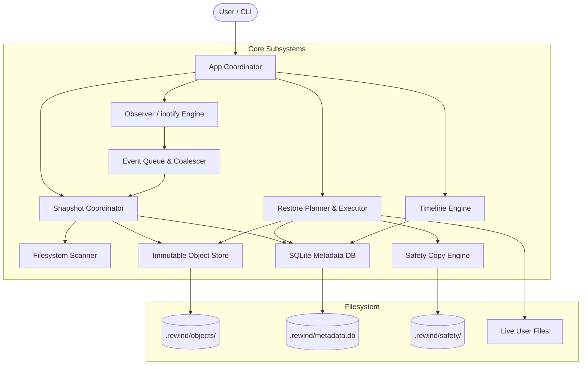
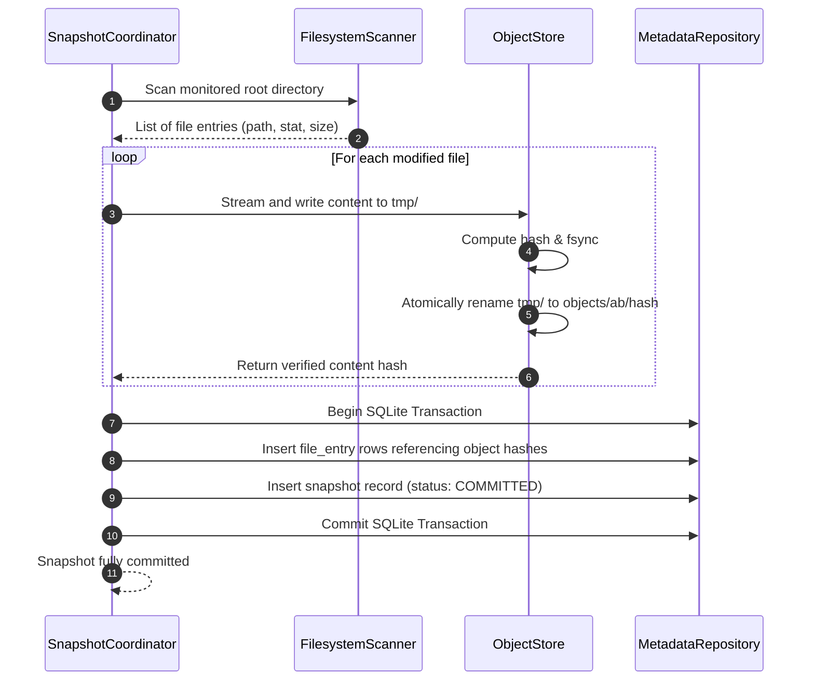
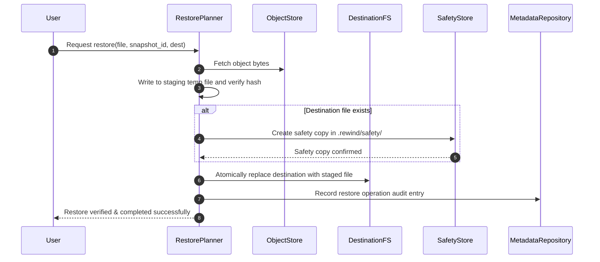

# UML & Sequence Diagrams

> **Status:** Outline / Planned  
> **Diagram Format:** Mermaid

## 1. System Architecture Diagram

## 2. Snapshot Commit Protocol Sequence

## 3. Restore Safety Protocol Sequence

---
*Comprehensive class diagrams, statecharts, and component models will be integrated during implementation.*
